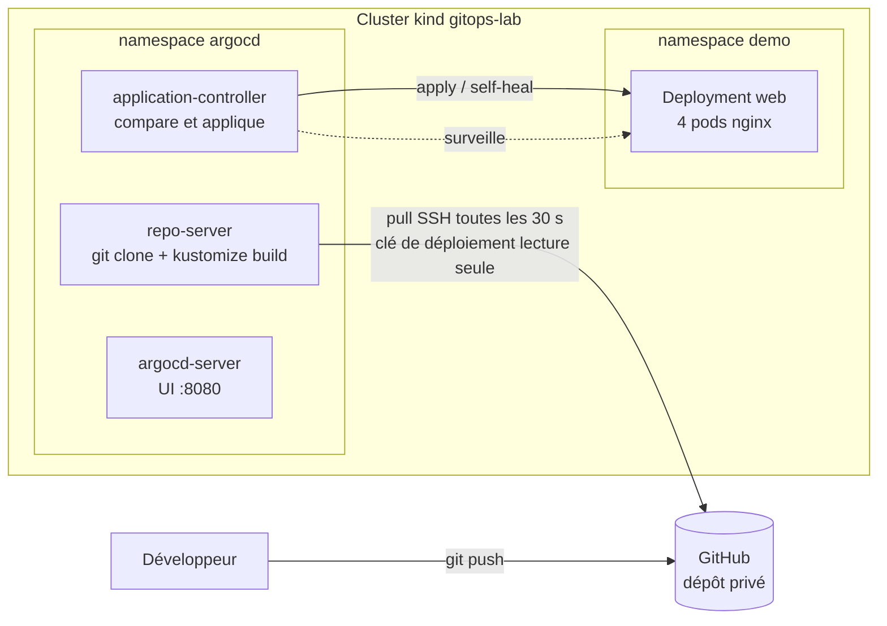
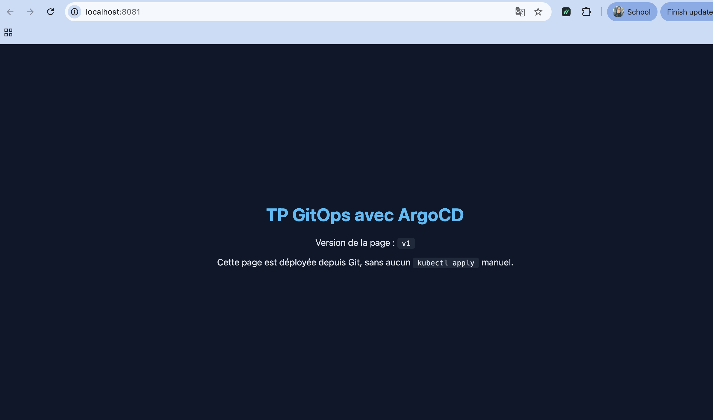
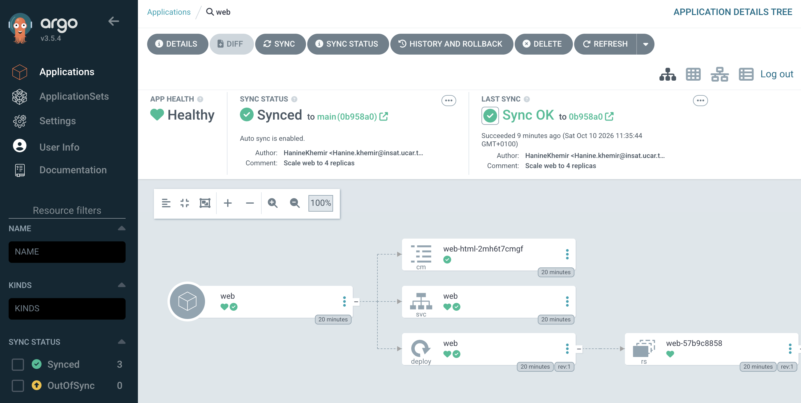
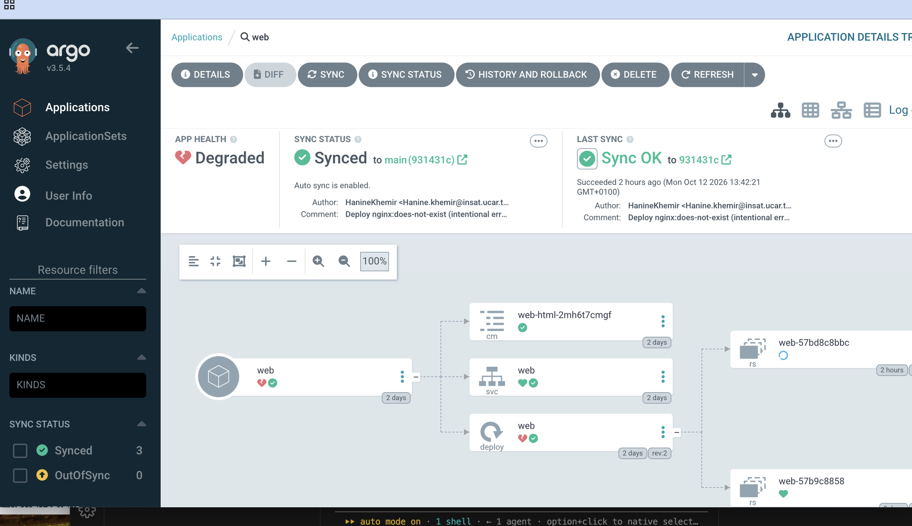
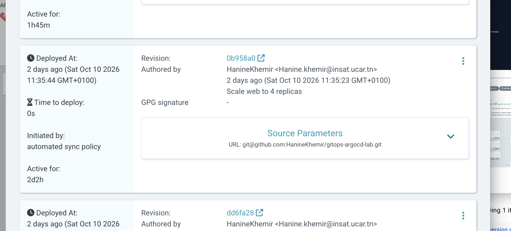
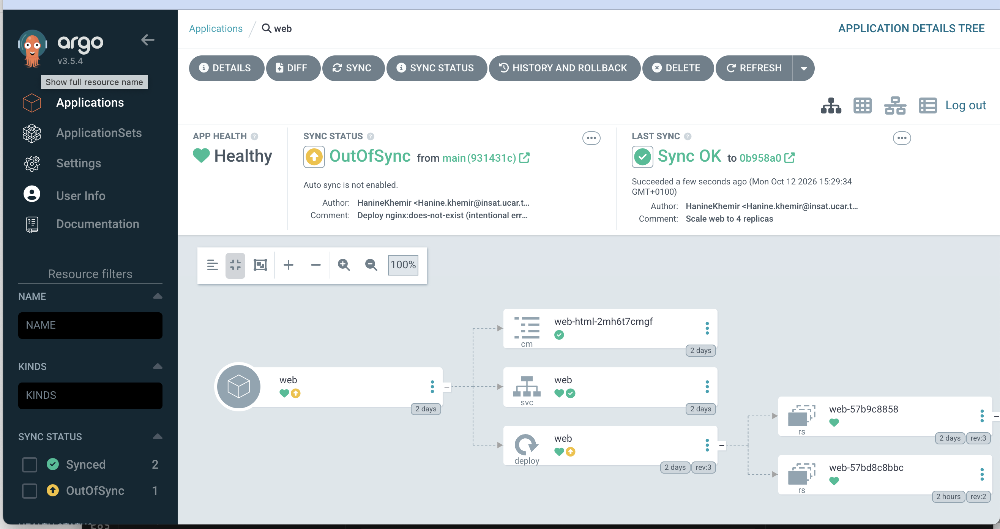

<p align="center">
  
</p>

<h1 align="center">TP 1 : GitOps and Continuous Deployment</h1>
<h3 align="center">Compte rendu — Continuous Deployment avec ArgoCD</h3>

<p align="center">
  <b>Réalisé par :</b><br>
  Youssef Khalifa<br>
  Hanine Khemir<br>
  Oussema Said<br>
  Ahmed Amine Bououd
</p>

<p align="center">
  <b>Classe :</b> GL4 — Groupe 1
</p>

---

**Dépôt :** https://github.com/HanineKhemir/gitops-argocd-lab

**Outils :** kind (Kubernetes v1.36.1), ArgoCD v3.5.4, Kustomize (intégré à kubectl v1.34), GitHub

---

## 1. Objectif

Mettre en place un pipeline GitOps de bout en bout : l'état désiré de l'application est décrit de façon déclarative dans un dépôt Git, et ArgoCD, installé dans le cluster, applique automatiquement cet état et le maintient. Quatre scénarios démontrent le déploiement continu, l'auto-réparation (self-healing), la différence entre Sync et Health, et le rollback.

L'application choisie est volontairement simple : un serveur **NGINX** qui sert une page HTML personnalisée. L'évaluation porte sur le pipeline GitOps, pas sur l'application.

## 2. Architecture



**Modèle pull :** c'est ArgoCD, à l'intérieur du cluster, qui va chercher l'état désiré sur GitHub. Aucun outil externe (CI, poste développeur) ne dispose d'un accès au cluster pour y pousser des changements.

## 3. Structure du dépôt (Single Source of Truth)

```
app/
  base/                     # description commune à tous les environnements
    deployment.yaml         # nginx, sondes, ressources, progressDeadlineSeconds: 30
    service.yaml            # NodePort 30080 -> http://localhost:8081
    index.html              # page servie par nginx
    kustomization.yaml      # ressources + configMapGenerator(index.html)
  overlays/dev/
    kustomization.yaml      # namespace demo, nombre de répliques, tag d'image
argocd/
  install/                  # installation d'ArgoCD v3.5.4 (version figée) + patch
  application.yaml          # l'Application ArgoCD : source Git -> destination cluster
kind/cluster.yaml           # définition du cluster local
docs/                       # ce compte rendu et les captures
```

Choix de conception :

- **Kustomize (base + overlay)** plutôt que du YAML brut : la base décrit l'application, l'overlay `dev` ne contient que ce qui varie (namespace, répliques, image). Chaque démonstration se réduit à une modification d'une ligne de `app/overlays/dev/kustomization.yaml`.
- **`configMapGenerator`** : le nom du ConfigMap est suffixé par un hash de son contenu (`web-html-2mh6t7cmgf`). Modifier `index.html` change ce nom et déclenche donc un nouveau déploiement des pods.
- **`progressDeadlineSeconds: 30`** : délai après lequel Kubernetes déclare un déploiement bloqué en échec. La valeur par défaut (600 s) laisserait ArgoCD en état *Progressing* pendant 10 minutes avant de passer en *Degraded*.
- **`maxUnavailable: 0`** : un ancien pod n'est supprimé que lorsqu'un nouveau pod est prêt. Une mauvaise image ne provoque donc pas d'interruption de service.

## 4. Mise en place

| Étape | Commande / action | Résultat |
|---|---|---|
| Cluster | `kind create cluster --config kind/cluster.yaml` | 1 nœud Kubernetes v1.36.1, port 30080 publié sur `localhost:8081` |
| ArgoCD | `kubectl create ns argocd` puis `kubectl apply --server-side -k argocd/install` | 7 pods ArgoCD v3.5.4 en Running |
| Accès au dépôt privé | Clé SSH ed25519 enregistrée sur GitHub comme **deploy key en lecture seule** ; clé privée stockée dans un Secret `argocd` portant le label `argocd.argoproj.io/secret-type=repository` | ArgoCD lit le dépôt, sans droit d'écriture ni accès aux autres dépôts |
| Application | `kubectl apply -f argocd/application.yaml` | Application `web` **Synced / Healthy** en 21 s |
| Interface | `kubectl -n argocd port-forward svc/argocd-server 8080:443` | UI sur https://localhost:8080 |

L'`Application` ArgoCD active les trois options de synchronisation automatique :

```yaml
syncPolicy:
  automated:
    enabled: true
    prune: true     # supprime du cluster ce qui a été retiré de Git
    selfHeal: true  # annule toute modification manuelle faite sur le cluster
  syncOptions:
    - CreateNamespace=true
```

L'intervalle d'interrogation de Git a été réduit de 180 s à **30 s** (`timeout.reconciliation` dans `argocd-cm`) pour rendre les démonstrations visibles en direct.

Après ce `kubectl apply`, **plus aucune ressource de l'application n'a été créée à la main** : le namespace `demo`, le ConfigMap, le Service et le Deployment ont tous été créés par ArgoCD à partir de Git.



**Seule exception à « tout est dans Git » :** le Secret contenant la clé privée SSH, volontairement absent du dépôt (`.secrets/` est ignoré par Git). En production, on utiliserait Sealed Secrets ou External Secrets pour versionner une forme chiffrée de ce secret.

## 5. Scénarios de démonstration

Historique Git produit pendant les démonstrations :

| Commit | Message | Scénario |
|---|---|---|
| `620bcc2` | Add nginx app as Kustomize base and dev overlay | Mise en place |
| `dd6fa28` | Add kind cluster config, pinned ArgoCD install and Application | Mise en place |
| `0b958a0` | Scale web to 4 replicas | 1 |
| `931431c` | Deploy nginx:does-not-exist (intentional error) | 3 |
| `7ba902c` | Revert "Deploy nginx:does-not-exist (intentional error)" | 4 |
| `70e8a34` | Set automated sync enabled explicitly in Application | 4 |

### Scénario 1 — Déploiement continu automatisé

**Action :** dans `app/overlays/dev/kustomization.yaml`, passage de `count: 2` à `count: 4`, puis `git commit` et `git push` (commit `0b958a0`). Aucune commande n'est exécutée sur le cluster.

**Observation :**

| Temps après le push | Révision déployée | Statut | Pods prêts |
|---|---|---|---|
| 0 à 20 s | `dd6fa28` | Synced / Healthy | 2/2 |
| 23 s | `0b958a0` | Synced / Healthy | **4/4** |

Le temps de réaction dépend du moment où tombe la prochaine interrogation de Git (au plus 30 s). Le bouton **Refresh** de l'UI force cette interrogation sans rien pousser vers le cluster.



L'UI indique **Synced to main (0b958a0)** et **Sync OK**, avec le message du commit « Scale web to 4 replicas » ; la colonne *Initiated by* de l'historique indique *automated sync policy* (aucune action manuelle).

**Conclusion :** une modification dans Git suffit à modifier le cluster. Git est la source de vérité, ArgoCD est le seul acteur qui applique.

### Scénario 2 — Détection du drift et self-healing

**Action 1 :** suppression manuelle de la ressource : `kubectl -n demo delete deployment web`.

| Temps | Statut ArgoCD | Deployment | Page web |
|---|---|---|---|
| 0 s | Synced / Healthy | absent | indisponible |
| 2 s | OutOfSync | recréé, pods en démarrage | indisponible |
| 3 s | Synced / Healthy | 4/4 | HTTP 200 |

Le Deployment recréé a une date de création postérieure d'une seconde à la suppression : c'est un nouvel objet reconstruit depuis Git.

**Action 2 :** modification manuelle : `kubectl -n demo scale deployment web --replicas=1`.

| Temps | Statut ArgoCD | `spec.replicas` | Pods prêts |
|---|---|---|---|
| 0 s | OutOfSync / Healthy | 1 | 1 |
| 1 s | Synced / Progressing | **4** | 2 |
| 3 s | Synced / Healthy | 4 | 4 |

Événements enregistrés par ArgoCD :

```
Updated sync status: Synced -> OutOfSync
Initiated automated sync to '0b958a0...'
Partial sync operation to 0b958a0... succeeded
Updated sync status: OutOfSync -> Synced
```

**Conclusion :** toute modification faite directement sur le cluster est détectée et annulée en quelques secondes. La réaction est bien plus rapide qu'au scénario 1 car ArgoCD **surveille** les ressources du cluster en continu (watch sur l'API Kubernetes), alors qu'il **interroge** Git périodiquement.

### Scénario 3 — Gestion des erreurs : Sync vs Health

**Action :** dans l'overlay, `newTag: 1.27-alpine` devient `newTag: does-not-exist`, puis commit et push (`931431c`).

| Temps après le push | Révision | Sync | Health | Nouveau pod | Page web |
|---|---|---|---|---|---|
| 0 à 35 s | `0b958a0` | Synced | Healthy | — | 200 |
| 39 s | `931431c` | **Synced** | Progressing | ContainerCreating | 200 |
| 43 à 68 s | `931431c` | **Synced** | Progressing | ErrImagePull / ImagePullBackOff | 200 |
| 72 s | `931431c` | **Synced** | **Degraded** | ErrImagePull | 200 |

Erreur remontée par le pod :

```
failed to pull and unpack image "docker.io/library/nginx:does-not-exist":
failed to resolve reference ... not found
```

Condition du Deployment : `ProgressDeadlineExceeded: ReplicaSet "web-57bd8c8bbc" has timed out progressing.`



**Analyse :**

- **Sync status** répond à la question *« le cluster correspond-il à Git ? »*. Oui : Git demande `nginx:does-not-exist` et c'est exactement ce qui est déclaré dans le cluster. ArgoCD a correctement fait son travail.
- **Health status** répond à la question *« l'application fonctionne-t-elle ? »*. Non : l'image n'existe pas, le nouveau pod ne peut pas démarrer, et Kubernetes déclare le déploiement en échec après 30 s.

**Synced ne signifie pas fonctionnel** : ArgoCD garantit que le cluster reflète Git, même lorsque Git contient une erreur.

Grâce à `maxUnavailable: 0`, les 4 anciens pods (`nginx:1.27-alpine`) sont restés en service pendant tout l'incident ; la page a répondu HTTP 200 à chaque vérification.

### Scénario 4 — Historique et rollback

**Action :** dans l'UI, onglet **History and Rollback**, choix de la révision stable `0b958a0` (« Scale web to 4 replicas »), puis **Rollback**.



ArgoCD refuse un rollback tant que la synchronisation automatique est active (elle réappliquerait immédiatement le commit défectueux depuis Git) ; l'UI propose donc de la désactiver.

**Résultat :**



- **Healthy** : le cluster exécute de nouveau la révision `0b958a0`, avec 4 pods `nginx:1.27-alpine`.
- **OutOfSync from main (931431c)** : Git contient toujours le commit défectueux ; le cluster est volontairement en retard sur Git.
- **Auto sync is not enabled** : la synchronisation automatique a été suspendue par le rollback.

**Retour à un état GitOps cohérent :** le rollback dans l'UI est une mesure d'urgence ; la correction durable doit passer par Git.

1. `git revert 931431c` puis push (commit `7ba902c`). Le tag redevient `1.27-alpine`. Dès qu'ArgoCD compare avec ce commit, l'application redevient **Synced** sans aucune synchronisation : le cluster (après rollback) et Git (après revert) décrivent le même état.
2. Réactivation de la synchronisation automatique en réappliquant `argocd/application.yaml`.

**Difficulté rencontrée :** sous ArgoCD v3, le rollback désactive l'auto-sync en écrivant `automated.enabled: false`. Notre fichier ne mentionnant pas ce champ, `kubectl apply` ne détectait aucune différence (`unchanged`) et l'auto-sync restait désactivé. Correction : déclarer explicitement `enabled: true` dans `application.yaml` (commit `70e8a34`). Après réapplication, l'auto-sync et le self-heal sont de nouveau actifs ; un `kubectl scale --replicas=1` est annulé en moins de 4 secondes.

**État final :** révision `7ba902c`, **Synced / Healthy**, 4 pods `nginx:1.27-alpine`, page en HTTP 200.

## 6. Difficultés rencontrées

| Problème | Cause | Solution |
|---|---|---|
| Application en *Progressing* pendant 10 min avec une mauvaise image | `progressDeadlineSeconds` vaut 600 s par défaut | Réduit à 30 s dans la base |
| Changements Git visibles seulement après ~3 min | Intervalle d'interrogation par défaut de 180 s | `timeout.reconciliation: 30s` via un patch Kustomize de `argocd-cm` |
| Erreur de taille d'annotation à l'installation d'ArgoCD | CRD trop volumineuses pour `kubectl apply` côté client | `kubectl apply --server-side` |
| Dépôt privé illisible par ArgoCD | Aucune authentification configurée | Deploy key SSH en lecture seule + Secret labellisé `repository` |
| Auto-sync non réactivé après le rollback | Champ `enabled: false` posé par ArgoCD v3, absent de notre YAML | `enabled: true` déclaré explicitement |
| Cluster et UI indisponibles par moments | Docker Desktop fermé, ce qui arrête le nœud kind | Redémarrer Docker Desktop avant la démonstration ; le cluster redémarre avec son état |

## 7. Conclusion

Le pipeline démontre les cinq concepts demandés :

| Concept | Démonstration |
|---|---|
| Single Source of Truth | Toute l'application est décrite dans le dépôt Git (Kustomize) ; seul le Secret de la clé SSH en est exclu, volontairement |
| GitOps pull-based | ArgoCD, dans le cluster, interroge GitHub ; aucun accès externe au cluster n'est nécessaire (scénario 1) |
| Drift et self-healing | Suppression et mise à l'échelle manuelles annulées en 1 à 3 s (scénario 2) |
| Sync vs Health | Application **Synced** mais **Degraded** avec une image inexistante (scénario 3) |
| Historique et rollback | Retour à `0b958a0` depuis l'UI, puis correction durable par `git revert` (scénario 4) |

Le principal enseignement est que Git devient le seul point d'entrée des modifications : un changement manuel est effacé, un changement dans Git est appliqué, et l'historique Git sert d'historique de déploiement.
